<picture>
  <source media="(prefers-color-scheme: dark)" srcset="https://raw.githubusercontent.com/zoek1211/zoek1211/main/dist/pet.svg">
  <source media="(prefers-color-scheme: light)" srcset="https://raw.githubusercontent.com/zoek1211/zoek1211/main/dist/pet-light.svg">
  
</picture>

<picture>
  <source media="(prefers-color-scheme: dark)" srcset="https://raw.githubusercontent.com/zoek1211/zoek1211/main/dist/graph.svg">
  <source media="(prefers-color-scheme: light)" srcset="https://raw.githubusercontent.com/zoek1211/zoek1211/main/dist/graph-light.svg">
  
</picture>
